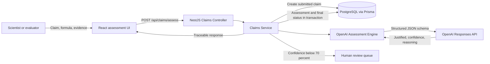

# Claims Intelligence Engine Architecture

## Runtime sequence

1. The React client validates required input and submits the exact proposed claim, formula description, and study evidence.
2. NestJS validates length and type constraints, then records the submitted claim before invoking the model.
3. The OpenAI adapter requests schema-constrained output. Its prompt requires an exact match on wording, magnitude, population, endpoint, comparator, and timeframe and forbids inventing missing evidence.
4. Prisma saves the assessment and updates the claim status together. Results below 70 percent confidence are marked `REVIEW_REQUIRED`.
5. The UI shows the recommendation, confidence, rationale, review flag, and trace identifier. The output supports an evaluator; it does not replace approval.

## Boundary rationale

- The assessment engine is an interface so model providers, model versions, and deterministic test doubles do not leak into business logic.
- The API owns validation and persistence; the browser never receives an OpenAI credential.
- The raw evidence and model metadata create an audit trail, while `promptVersion` supports later evaluation and controlled rollout.
- A database transaction keeps the assessment record and claim status consistent.
